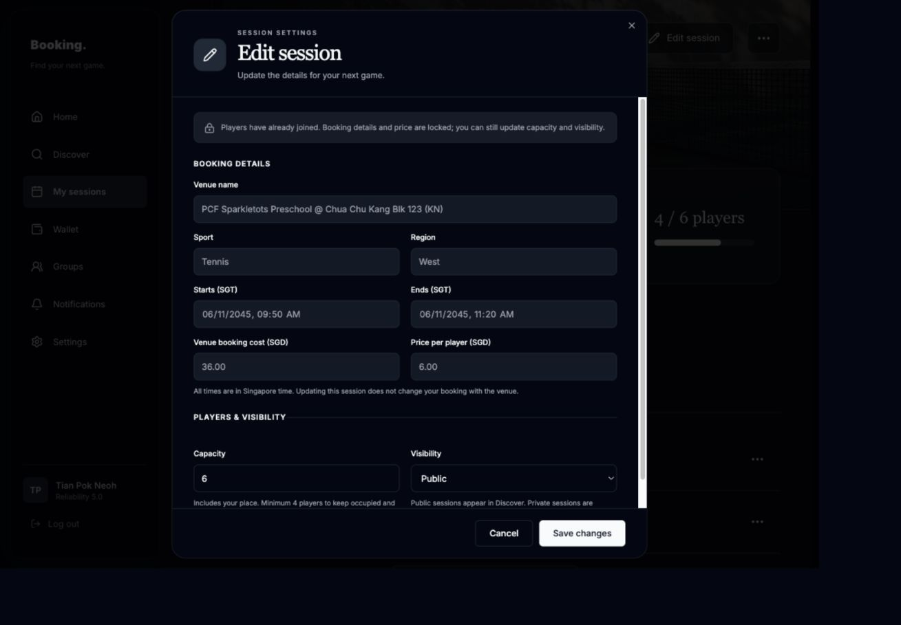
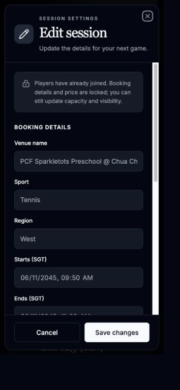

# Session editing verification

The participant page's Edit session button opens a prefilled, responsive dialog.
An active owner can save an upcoming OPEN session. Booking terms lock after
participation history exists; capacity includes the booker and occupied,
reserved and forfeited places. Existing payments and participant history are
preserved. Conflicting edits require reloading current details.

## Checks

- `npm test`: 3,647 passed, 75 skipped, one existing todo.
- Focused Storybook suite (`session-edit-dialog` and `session-player-management`):
  19 passed, including accessibility, focus restoration, failed-save input
  retention, pending-save lockout, conflict reload, full capacity, Singapore
  midnight conversion and visibility/capacity transitions.
- PostgreSQL management suite: 18 passed, including persistence, rollback,
  stale admission/history, held-fund preservation and the real authenticated
  GET/PATCH editing API with a different-owner denial.
- `npm run typecheck`, `npm run lint`, `npm run build` and `git diff --check` passed.
- Desktop light/dark and phone previews were inspected. The phone dialog stays
  within its viewport; the footer remains accessible while fields scroll.
- Independent branch review found a visibility display/submission mismatch when
  capacity became full. A browser regression failed first, then passed after
  controlling the displayed and submitted visibility together. No other blockers
  or deferred minor findings were reported.

Default integration ports 55321/55322 were occupied by another disposable test
stack. Testing used a separate disposable stack on 55421/55422 and temporary
copies of the existing test runner and safety guards with those port values.
Tracked infrastructure and the other stack were preserved.

The broader `session-participant-controls` **Review Refund** story fails its
existing `Who gets your place?` assertion. The same failure was reproduced from
unchanged `origin/main` (`aed05ed`) using the same dependencies. It is separate
from the editing workflow.

No migration is required. No live database changes or deployment were performed.
The shared sidebar has no diff.

## Previews

